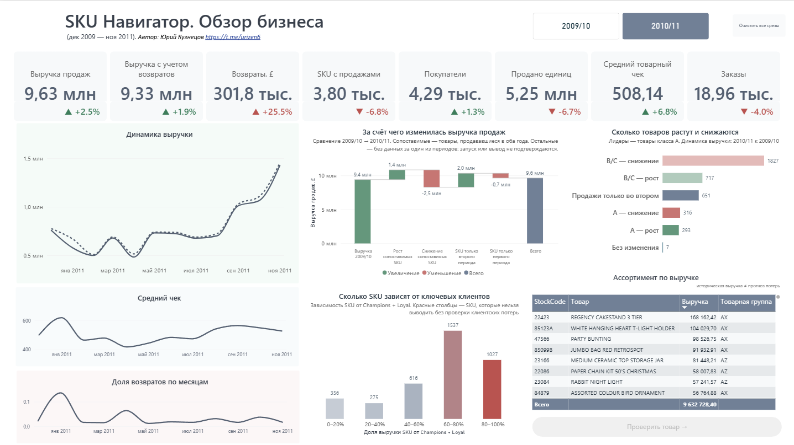
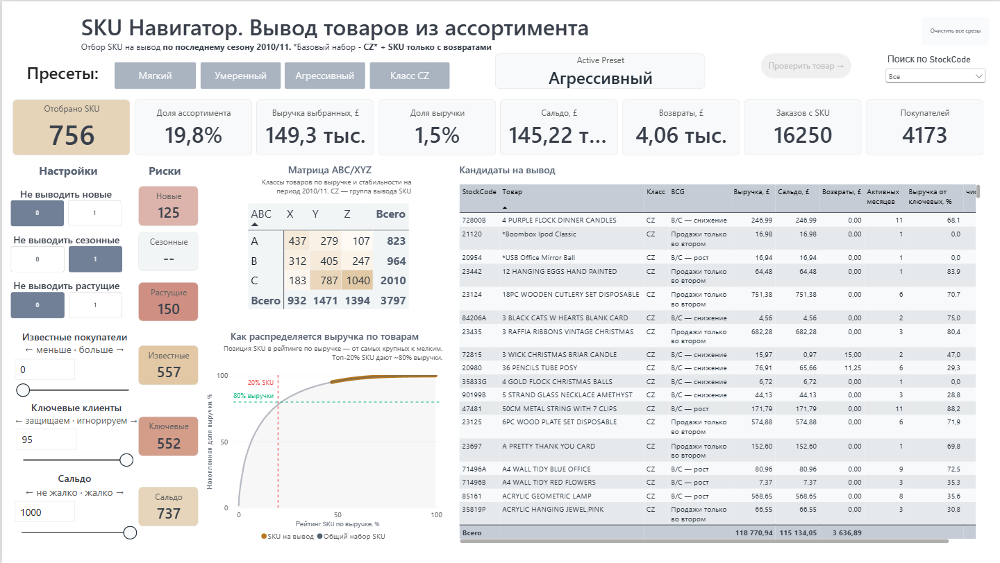
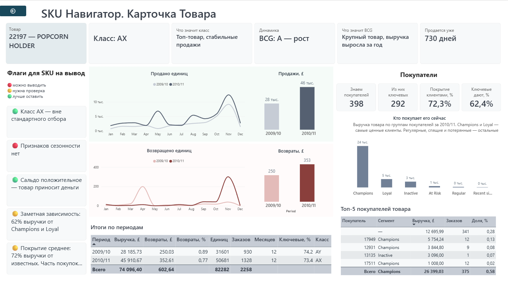

# SKU-навигатор

### Продажи, клиенты и ассортимент: что сохранить, что пересмотреть.

**Интерактивный инструмент поддержки решений по ассортименту в Power BI.** Проект объединяет исследование транзакций, ETL-пайплайн и трёхстраничный дашборд: от обзора магазина до настройки сценария сокращения и проверки конкретного товара.

Главный результат — **не статический список SKU, а работающий конструктор отбора**. Пользователь меняет критерии, сразу видит состав кандидатов, их вклад в выручку и риски, затем изучает спорные позиции в карточке товара. Для этого не нужно редактировать Python-код или вручную пересобирать таблицы.

**Стек:** Python · pandas · NumPy · Jupyter Notebook · Parquet · Power BI · Power Query · DAX

## Дашборд

### 1. Обзор магазина



### 2. Отбор SKU — конструктор



### 3. Карточка товара



**Файл дашборда:** [`Power BI/SKU_navigator.pbix`](Power%20BI/SKU_navigator.pbix)

## Бизнес-задача

Британский интернет-магазин подарков и товаров для дома рассматривает сокращение примерно **20% товарных позиций**. Цель анализа — определить, какие товары важно сохранять в наличии, где стоит ограничить запас, а какие позиции можно рассматривать на вывод.

Простое удаление низкооборотных SKU рискованно: среди них могут оказаться сезонные товары, позиции с короткой историей, растущими продажами или значимой ролью для ключевых покупателей.

**Критерий результата:** сопоставить долю отобранного ассортимента с долей связанной с ним исторической выручки и показать ограничения решения. Ориентир 20% — не требование сократить ассортимент любой ценой.

## Что получил пользователь

- **Обзор бизнеса:** продажи, возвраты, заказы, покупатели, средний чек и изменение выручки между периодами.
- **Три готовых сценария:** мягкий, умеренный и агрессивный — отправные точки для проверки разных масштабов сокращения.
- **Собственный сценарий:** переключатели защитных условий и числовые пороги вместо единственного жёстко заданного списка.
- **Оценку выбранного набора:** количество и доля SKU, выручка и её доля, сальдо, возвраты, заказы и покупатели.
- **Проверку каждого товара:** история продаж, сезонность, возвраты, клиентский состав и объяснимые сигналы для решения.

Инструмент рассчитан на руководителя, аналитика и сотрудников, работающих с ассортиментом и складом. Он помогает подготовить решение, но не заменяет проверку остатков, маржи и условий поставки.

## Дашборд: обзор → отбор → проверка

### 1. Обзор магазина

**Вопрос: как работает бизнес и какие товары определяют результат?**

- Восемь KPI: выручка продаж, выручка с учётом возвратов, возвраты, SKU с продажами, покупатели, проданные единицы, средний чек и заказы.
- Месячная динамика выручки, среднего чека и отношения возвратов к продажам.
- Водопад изменения выручки: рост и снижение сопоставимых SKU, вклад товаров с продажами только в одном из периодов.
- Группировка товаров по значимости и динамике: лидеры класса A и остальной ассортимент B/C.
- Распределение SKU по доле выручки от ключевых клиентов — Champions и Loyal.
- Таблица товаров с переходом в карточку выбранного SKU.

Годовые показатели доступны по двум периодам; межгодовые визуализации показывают их сравнение.

### 2. Отбор SKU — интерактивный конструктор

**Вопрос: какие товары соответствуют выбранным условиям и каков масштаб такого отбора?**

**Базовый пул кандидатов = класс CZ + SKU только с возвратами.** Класс CZ — это товары с низким вкладом в выручку и высокой вариативностью продаж. Дополнительно в базовый набор входят **SKU, у которых в периоде не было положительных продаж, но есть отрицательные операции (возвраты)**. Такие позиции формально не приносят выручки, но требуют решения: возможно, это корректировки, переоформления или разовые исправления учёта.

**Принадлежность к CZ не является достаточным основанием для вывода.** Сценарии дополняются защитными условиями.

| Настройка | Для чего используется |
|---|---|
| Не включать товары с короткой историей | Не принимать решение по недостаточному периоду наблюдения |
| Не включать сезонные | Защитить позиции с повторяющимися пиками продаж |
| Не включать растущие | Не отбирать товары с положительной динамикой |
| Минимальное клиентское покрытие, % | Требовать достаточную долю продаж с известным покупателем |
| Максимальная доля выручки от ключевых клиентов, % | Ограничить отбор товаров, значимых для Champions и Loyal |
| Максимальное сальдо, £ | Задать верхнюю границу выручки SKU с учётом возвратов |

При изменении условий пересчитываются список кандидатов, карточки результата и индикаторы рисков. Матрица ABC/XYZ и кривая Парето показывают положение выбранных товаров в структуре ассортимента.

**Пример работы:** выбрать мягкий сценарий → ослабить порог клиентского покрытия → оценить прирост числа SKU и их выручки → проверить появившиеся риски → открыть карточки спорных товаров.

Доли ассортимента и выручки рассчитываются относительно полной базы анализируемого периода — **3 811 SKU во втором периоде** (включая 14 позиций только с возвратами), а не внутри уже отфильтрованного списка.

### 3. Карточка товара

**Вопрос: почему этот SKU требует внимания и что проверить перед решением?**

Переход из обзора или списка кандидатов через Drillthrough открывает:

- код, название, ABC/XYZ, адаптированную BCG и наблюдаемую историю товара;
- продажи и возвраты по месяцам с сопоставлением двух годовых периодов;
- показатели выручки, количества, заказов и покупателей;
- клиентское покрытие и вклад Champions/Loyal;
- выручку по RFM-сегментам и топ-5 покупателей;
- сигналы по классу, сезонности, сальдо и клиентским показателям, а также текстовый ориентир для решения.

Цветовые сигналы помогают расставить приоритеты проверки. Они не означают, что вывод товара гарантированно безопасен.

## Практические результаты исследования

Контрольный расчёт в исследовательском ноутбуке за **2010/11** сформировал три сценария на базе **3 811 SKU анализируемого периода** — это класс **CZ (1 040 SKU)** **плюс 14 SKU, у которых в периоде были только возвраты без положительных продаж**. Сценарии различаются набором защитных фильтров и ограничений по клиентской зависимости.

| Сценарий | SKU-кандидаты | Доля ассортимента | Целевой % | Историческая выручка продаж | Доля выручки продаж |
|---|---:|---:|---:|---:|---:|
| Мягкий | 79 | 2,07% | 2% | £4 008,81 | ≈0,04% |
| Умеренный | 278 | 7,29% | 5% | £19 314,73 | ≈0,20% |
| Агрессивный | 756 | 19,84% | 20% | £118 770,94 | ≈1,23% |

**Ключевой результат:** удалось выделить пул, близкий к бизнес-ориентиру — **19,84% ассортимента**, связанного примерно с **1,2% исторической выручки продаж**. Это обосновывает дальнейшую проверку, а не автоматическое удаление всех 756 позиций.

В исследовательском агрессивном сценарии **170 SKU получили статус ручной проверки**. Среди причин — неположительное сальдо, аномальные возвраты (доля возвратов в выручке > 50%) и высокая зависимость от Champions/Loyal (доля их выручки > 80%). Сезонные товары исключены из всех сценариев фильтром — это защита, а не кандидаты на вывод.

**SKU только с возвратами** (14 позиций во втором периоде) входят в базовый набор сценариев, потому что формально не приносят выручки. Но перед решением стоит проверить: не являются ли эти операции корректировками, переоформлениями или разовыми исправлениями. Наличие возврата без соответствующей продажи в периоде может отражать особенность учёта, а не проблему с товаром.

**Вложенность сценариев сохранена:** мягкий ⊂ умеренный ⊂ агрессивный. Это подтверждает корректность настройки фильтров — более строгий сценарий всегда даёт подмножество более широкого.

> Таблица фиксирует результат исследовательского ноутбука. В Power BI отбор рассчитывается динамически; после уточнений ETL и изменения настроек пресетов число кандидатов может отличаться. Для конкретного решения используются значения и условия текущего отбора в дашборде.

### Главные выводы

1. **Выручка концентрирована:** около 21–22% продававшихся SKU формируют 80% выручки (21,68% в 2010/11, 22,56% в 2009/10). Более половины ассортимента относится к C и даёт около 5% выручки.
2. **Приоритет наличия — экономически значимые товары:** AX и AY обеспечивают около **70,70% выручки в 2009/10 и 71,51% в 2010/11**. Для AZ также важен контроль доступности, но с учётом высокой вариативности продаж.
3. **Текущий низкий класс не всегда означает исторически слабый товар:** бывшие товары A объясняют **60,21%** снижения выручки внутри группы «B/C — снижение» среди сопоставимых SKU.
4. **Клиентская роль важна для товарных решений:** Champions и Loyal формируют **85,00%** выручки продаж с известным покупателем во втором периоде (57,00% Champions + 28,00% Loyal). Это не доля от всей выручки магазина — клиентский анализ охватывает 85,39% общей выручки второго периода.
5. **Высокий CV не объясняет причину колебаний:** в Z могут попадать сезонные товары, позиции с короткой историей и редкими крупными заказами. Нужны дополнительные признаки.
6. **Масштаб сокращения можно обсуждать предметно:** сценарии связывают конкретный список SKU с его исторической выручкой, клиентской значимостью и рисками.
7. **Позиции только с возвратами требуют отдельного разбора:** 14 SKU во втором периоде не имеют положительных продаж, но имеют отрицательные операции. Они включены в базовый набор сценариев, но перед решением нужно понять природу этих операций.

Практическая последовательность — начать с наиболее строгого отбора, проверить его с бизнесом и расширять условия по мере готовности принимать дополнительные риски. Для части товаров альтернативой выводу может стать ограниченный запас, сезонная закупка или работа под заказ.

## Данные и методика

**Источник:** [Online Retail II — UCI Machine Learning Repository](https://archive.ics.uci.edu/dataset/502/online+retail+ii).

Одна строка — позиция счёта. Исходные поля: номер счёта, код и описание товара, количество, цена, дата операции, покупатель и страна. Анализ охватывает продажи британского магазина, включая зарубежных покупателей, а не только операции по United Kingdom.

| Характеристика | Значение |
|---|---|
| Исходный объём | 1 067 371 строка |
| Удалено полных дубликатов | 34 335 |
| После очистки и ограничения периода | 996 187 строк |
| После исключения комиссии CRUK | 996 172 строки |
| Первый годовой период | 01.12.2009–30.11.2010 |
| Второй годовой период | 01.12.2010–30.11.2011 |
| Валюта | GBP (£) |

Два полных годовых окна сохраняют одинаковый сезонный состав и позволяют сравнивать товары между периодами. Неполный декабрь 2011 года исключён — 25 101 строка.

### Подготовка данных

Исследованы дубликаты, пересечение листов исходного Excel, пропуски, отмены, отрицательные количества, цены и служебные коды. Удалены полные дубликаты (34 335 строк: 12 133 внутрилистовых + 22 202 межлистовых), нетоварные позиции и операции, не соответствующие принятым правилам. Коды SKU нормализованы, описания сведены в справочник товаров.

**Нормализация SKU.** Все коды приведены к единому виду: `StockCode.strip().upper()`. Это устраняет расхождение между `85123a` и `85123A` — без нормализации они считались бы двумя разными товарами. Приведение к верхнему регистру восстановило исходное единство SKU и согласовало исследовательский ноутбук с ETL.

Товарные возвраты сохранены со знаком. Продажи без `CustomerID` участвуют в общих товарных и денежных показателях, но не образуют идентифицированных покупателей для RFM.

**SKU только с возвратами** — позиции, у которых в периоде нет положительных продаж, но есть отрицательные операции. Они не получают ABC/XYZ-класс (для классификации нет базы), но включаются в базовый набор сценариев вывода. В каждом периоде таких позиций 14.

**Итог очистки по периодам:**

| Период | Всего строк | Продажи | Отмены / возвраты | Выручка продаж | Возвраты | Сальдо |
|---|---:|---:|---:|---:|---:|---:|
| 2009/10 | 490 064 | 480 817 | 9 247 | £9 396 642,31 | £240 561,41 | £9 156 080,90 |
| 2010/11 | 506 123 | 497 787 | 8 336 | £9 632 728,40 | £301 809,80 | £9 330 918,60 |

### Аналитические методы

| Метод | Реализация и роль в решении |
|---|---|
| **ABC** | Выручка положительных продаж; границы накопительной доли 80% и 95%. Определяет экономическую значимость SKU |
| **XYZ** | CV месячного проданного количества: X ≤ 0,75; Y ≤ 1,5; Z > 1,5. Для каждого SKU учитываются все 12 месяцев, включая нулевые |
| **Адаптированная BCG** | Текущая значимость A/B/C и изменение выручки сопоставимых товаров между годами. Это внутренняя товарная группировка, не оценка рыночной доли |
| **RFM** | Давность, частота и сумма покупок по идентифицированным клиентам; связь сегментов с продажами каждого SKU |
| **Дополнительные признаки** | Активные месяцы, короткая история (≤ 90 дней), повторяющиеся сезонные пики, ограниченная база сравнения (1–2 активных месяца), возвраты и клиентское покрытие |

Пороги XYZ 0,75/1,5 выбраны после изучения распределения CV: при исходных границах 0,5/1,0 в Z попадало большинство SKU (62–67%). Пороги остаются рабочим правилом, а не доказательством предсказуемости спроса. При новых порогах распределение сбалансировано: ~20/38/42 (X/Y/Z).

### Ключевые показатели по периодам

| Показатель | 2009/10 | 2010/11 | Изменение |
|---|---:|---:|---:|
| Выручка продаж | £9 396 642,31 | £9 632 728,40 | +2,5% |
| Сумма возвратов | £240 561,41 | £301 809,80 | +25,5% |
| Сальдо | £9 156 080,90 | £9 330 918,60 | +1,9% |
| Продано единиц | 5 626 674 | 5 248 740 | −6,7% |
| Заказов | 19 743 | 18 957 | −4,0% |
| SKU с продажами | 4 073 | 3 797 | −6,8% |
| Известных покупателей | 4 239 | 4 293 | +1,3% |
| Средний чек | £475,95 | £508,14 | +6,8% |
| Единиц на заказ | 285,00 | 276,88 | −2,8% |
| Покрытие строк Customer ID | 80,16% | 75,17% | −4,99 п.п. |
| Отношение возвратов к продажам | 2,56% | 3,13% | +0,57 п.п. |

### ABC-классы

| Период | A | B | C |
|---|---:|---:|---:|
| 2009/10 | 919 SKU / 79,99% выручки | 1 072 SKU / 15,00% | 2 082 SKU / 5,00% |
| 2010/11 | 823 SKU / 79,98% выручки | 964 SKU / 15,02% | 2 010 SKU / 5,00% |

### XYZ-классы

| Период | X | Y | Z |
|---|---:|---:|---:|
| 2009/10 | 834 SKU (20,48%) | 1 509 SKU (37,05%) | 1 730 SKU (42,47%) |
| 2010/11 | 932 SKU (24,55%) | 1 471 SKU (38,74%) | 1 394 SKU (36,71%) |

### RFM-сегментация (второй период)

| Сегмент | Клиентов | Доля клиентов | Выручка | Доля выручки |
|---|---:|---:|---:|---:|
| Champions | 622 | 14,50% | £4 689 072 | 57,00% |
| Loyal | 1 557 | 36,30% | £2 300 136 | 28,00% |
| Recent single | 217 | 5,10% | £69 623 | 0,80% |
| At Risk | 563 | 13,10% | £592 517 | 7,20% |
| Regular | 475 | 11,10% | £203 969 | 2,50% |
| Inactive | 859 | 20,00% | £369 682 | 4,50% |

Вместе Champions и Loyal — **50,80% покупателей и 85,00% выручки** продаж с известным клиентом. Клиентский анализ охватывает **85,39%** общей выручки второго периода. Остальные **14,61%** — продажи без `Customer ID`, которые нельзя связать с сегментами.

### Единые определения показателей

- **Выручка продаж** — сумма положительных товарных операций.
- **Возвраты** — модуль суммы отрицательных товарных операций.
- **Выручка с учётом возвратов / сальдо** — сумма `Quantity × Price` с исходным знаком; возвраты повторно не вычитаются.
- **Средний товарный чек** — выручка продаж / уникальные заказы продаж, не среднее по строкам.
- **Отношение возвратов к продажам** — сумма возвратов / выручка продаж. Это не доля возвращённых заказов.
- **Клиентское покрытие SKU** — доля его выручки продаж с известным покупателем.
- **Доля ключевых клиентов в выручке SKU** — выручка от Champions/Loyal / вся выручка продаж этого SKU.

Выручка и сальдо не являются прибылью: себестоимости в данных нет.

## Техническая реализация

```text
Online Retail II (Excel → Parquet)
                 ↓
Исследование в Jupyter: очистка, сегментация, правила отбора
                 ↓
ETL: загрузка → очистка → признаки → витрины → проверки
                 ↓
Power BI: модель данных → DAX → интерактивный конструктор
                 ↓
Обзор бизнеса → оценка сценария → проверка SKU
```

ETL переносит принятые правила исследования в повторяемую подготовку данных. Parquet используется для ускорения повторного чтения и передачи витрин в BI.

| Таблица | Гранулярность | Назначение |
|---|---|---|
| `FactSales` | Позиция счёта | Продажи, возвраты, уникальные заказы и покупатели |
| `MartSkuPeriod` | SKU × годовой период | Классификации, товарные и клиентские признаки отбора |
| `MartSkuMonth` | SKU × месяц | Полные месячные ряды продаж и возвратов |
| `MartRfm` | Покупатель × период | RFM-показатели и сегменты |
| `DimProduct`, `DimCustomer`, `DimDate`, `DimPeriod` | Справочники | Единые ключи и фильтрация |

Модель построена по принципам звёздной схемы с общими справочниками и односторонними связями. В ETL рассчитываются годовые классификации и признаки; DAX отвечает за интерактивный отбор и показатели выбранного набора. Фиксированные таблицы сценариев не подменяют конструктор.

Контроль качества включает уникальность ключей, полноту месячных рядов, сверку денежных итогов транзакций и витрин, а также журнал выполнения `etl_summary.json`.

### Сценарии отбора (согласованы с DAX-пресетами Power BI)

| Параметр | Мягкий | Умеренный | Агрессивный |
|---|---|---|---|
| Базовая группа | CZ + returns-only | CZ + returns-only | CZ + returns-only |
| ExcludeNew | 1 | 1 | 0 |
| ExcludeSeasonal | 1 | 1 | 1 |
| ExcludeGrowing | 1 | 1 | 0 |
| CoverageMin | 50% | 0% | 0% |
| KeyShareMax | 30% | 50% | 95% |
| BalanceMax | £1 000 | £1 000 | £1 000 |
| Целевой % | 2% | 5% | 20% |
| **Факт** | **79 SKU (2,07%)** | **278 SKU (7,29%)** | **756 SKU (19,84%)** |
| К выводу | 61 | 256 | 586 |
| Ручная проверка | 18 | 22 | 170 |

**Важно:** в агрессивном сценарии защиты по новизне и росту ослаблены. Его список требует дополнительной проверки на новинки и растущие SKU. Мягкий и умеренный сохраняют эти защиты в полном объёме.

### Структура проекта

```text
SKU_navigator/
├── README.md
├── Screenshots/
│   ├── sku_navigator_1.png                
│   ├── sku_navigator_2.png                
│   └── sku_navigator_3.png               
├── notebooks/
│   ├── SKU Навигатор.ipynb             
│   ├── SKU ETL.ipynb                 
├── etl/
│   ├── __init__.py
│   ├── config.py                        
│   ├── extract.py                      
│   ├── clean.py                        
│   ├── features.py                      
│   ├── marts.py                     
│   ├── pipeline.py                      
│   ├── raw/
│   │   ├── online_retail_II.xlsx          # исключён из репозитория (большой файл)
│   │   └── online_retail_II.parquet       
│   └── data/
│       └── processed/                  
│           ├── FactSales.parquet
│           ├── MartSkuPeriod.parquet
│           ├── MartSkuMonth.parquet
│           ├── MartRfm.parquet
│           ├── DimProduct.parquet
│           ├── DimCustomer.parquet
│           ├── DimDate.parquet
│           ├── DimPeriod.parquet
│           └── etl_summary.json       
└── Power BI/
    └── SKU_navigator.pbix                
```

### Как воспроизвести

1. Скачать Online Retail II из UCI и указать локальные пути к данным в настройках проекта.
2. Для изучения методики выполнить исследовательский ноутбук «SKU Навигатор» последовательно сверху вниз.
3. Для подготовки BI-данных запустить ETL-пайплайн из корня проекта:

   ```bash
   python -m etl.pipeline
   ```

4. Проверить сформированные витрины и журнал ETL в каталоге выгрузки.
5. Открыть отчёт в Power BI Desktop, настроить локальные пути к витринам в Power Query и обновить данные.
6. На странице отбора выбрать пресет или собственные условия, затем перейти к проверке конкретного SKU.

Методика подготовки витрин также изложена в ноутбуке «SKU ETL». Для работы с Python необходимы зависимости, используемые в ноутбуках и ETL, включая pandas, NumPy и поддержку Excel/Parquet; для интерактивного отчёта — Power BI Desktop.

## Ограничения

- **Продажи не равны истинному спросу.** Нулевые продажи могут быть следствием отсутствия товара на складе.
- Нет себестоимости, маржи, остатков, периодов out-of-stock, стоимости хранения, сроков поставки и минимальных партий. Экономия от сокращения не рассчитана.
- Не оценены взаимозаменяемость товаров и их роль в корзине: низкооборотный SKU может дополнять основные покупки.
- RFM охватывает только идентифицированных покупателей. Низкая известная доля ключевых клиентов при слабом покрытии не доказывает отсутствие клиентского риска.
- Первая наблюдаемая продажа не обязательно совпадает с запуском товара. Повторяющиеся пики за два года — признак для проверки сезонности, а не её гарантия.
- Возвраты отражаются по дате операции и не сопоставлены автоматически с исходной покупкой. Неположительное сальдо требует разбора, а не вывода об убыточности.
- **SKU только с возвратами** не имеют ABC/XYZ-класса и клиентских метрик: для них нет базы расчёта. Включение их в базовый набор — рабочее решение, требующее проверки природы операций.
- **Историческая выручка кандидатов не является прогнозом будущих потерь.** После изменения ассортимента спрос может перераспределиться; результат необходимо проверять на фактических данных.

---

**Итог:** исследование преобразовано в рабочий BI-инструмент. Пользователь может самостоятельно сформировать объяснимый отбор, оценить его историческую значимость и проверить риски каждого товара — вместо применения единого списка на удаление.